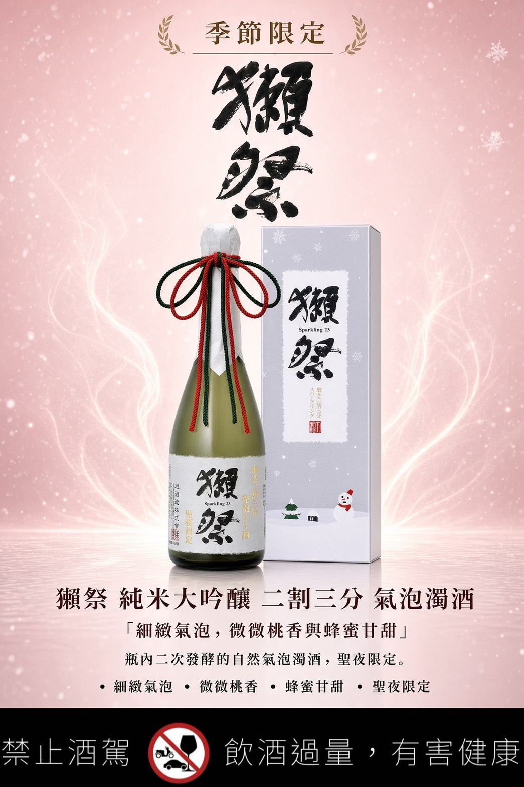
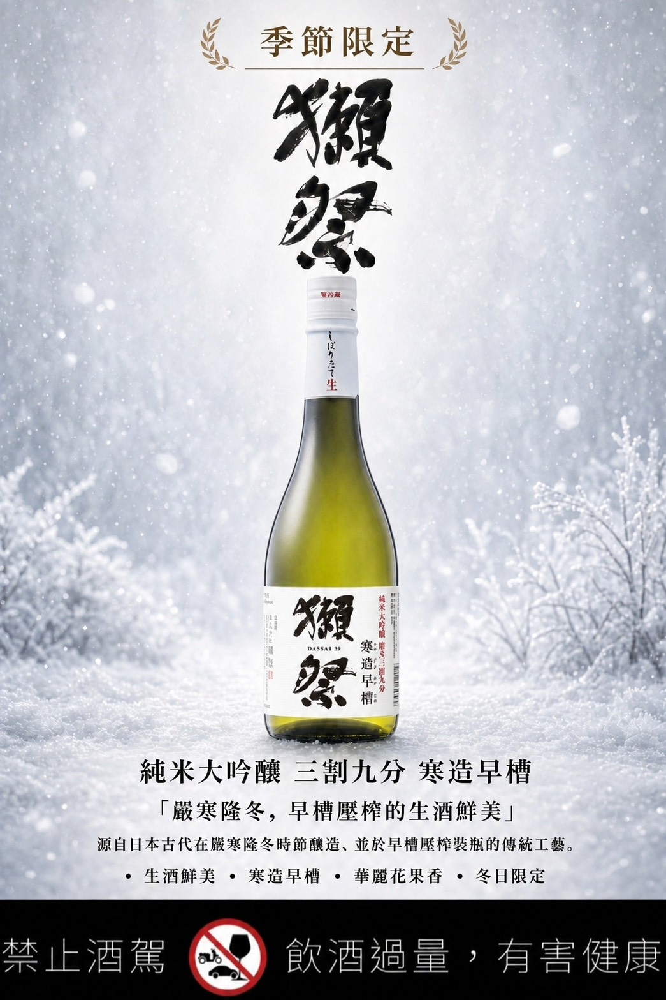
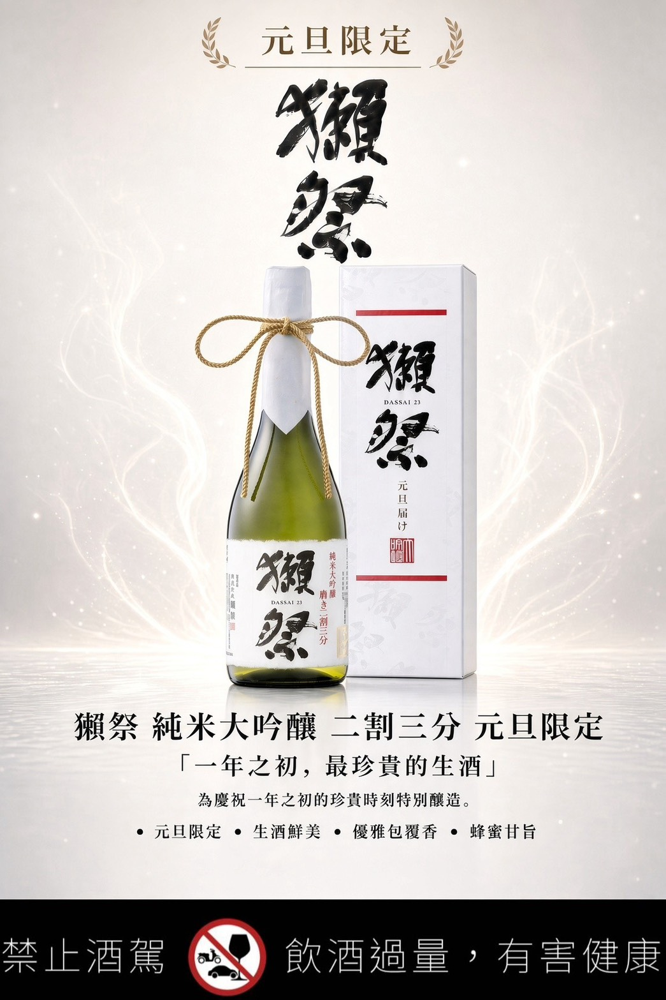

<!DOCTYPE html>
<html lang="zh-Hant">
<head>
<meta charset="UTF-8">
<meta name="viewport" content="width=device-width, initial-scale=1.0">
<meta name="theme-color" content="#171714">
<meta name="description" content="汰暄酒業｜獺祭季節限定預購。聖夜限定發泡濁酒、寒造早槽三割九分、元旦限定二割三分。">
<title>獺祭季節限定預購｜汰暄酒業 TaiXuan Online Wine</title>

<link rel="preconnect" href="https://fonts.googleapis.com">
<link rel="preconnect" href="https://fonts.gstatic.com" crossorigin>
<link href="https://fonts.googleapis.com/css2?family=DM+Sans:wght@400;500;600;700&family=Noto+Serif+TC:wght@400;500;600;700;900&display=swap" rel="stylesheet">

</head>

<body>

<!-- 導覽列 -->
<header class="nav">
  <a class="brand" href="#top">
    汰暄酒業
    <small>TAIXUAN ONLINE WINE</small>
  </a>

  <nav class="nav-links" aria-label="主要導覽">
    <a href="#products">限定酒款</a>
    <a href="#contact">聯絡我們</a>
    <a class="nav-cta" href="https://reurl.cc/dO1Rey"
       target="_blank" rel="noopener noreferrer">立即洽詢 ↗</a>
  </nav>
</header>

<main id="top">

<!-- Hero 主視覺
     將 hero.jpg 放在 index.html 同一資料夾。
     建議圖片尺寸：1920 × 1080 px。
-->
<section class="hero">
  

  

    
SEASONAL SAKE COLLECTION

    <h1>
      獺祭
      季節限定預購
    </h1>

    

      為冬日與新年，預留一份值得期待的清酒時光。 
      從聖夜的細緻氣泡，到新年限定的純米大吟釀， 
      三款季節之選，為重要時刻留下風味記憶。
    

    

      三款季節限定
      限量預購
      汰暄酒業精選
    

    

      <a class="btn btn-gold" href="#products">
        探索限定酒款 ↓
      </a>
      <a class="btn btn-outline"
         href="https://reurl.cc/dO1Rey"
         target="_blank" rel="noopener noreferrer">
        預購與庫存洽詢 ↗
      </a>
    

    

      ※ 預計到貨時間依各酒款標示，實際到貨以供應情況為準。
    

  

</section>

  <strong>SEASONAL PRE-ORDER</strong>
  &nbsp; 三款季節限定・即日起開放預購洽詢

<!-- 品牌引言 -->
<section class="intro container reveal">
  
A MOMENT WORTH CELEBRATING

  <h2 class="section-heading" style="margin:0">
    讓每一場相聚， 都有值得珍藏的理由。
  </h2>
  

  

    聖誕晚餐、新年團聚，或是獻給重要之人的一份心意。
    獺祭以不同季節限定酒款，為冬日餐桌帶來多一分期待。
    三款風格各異的季節之選，現在就為喜愛的酒款預留名額。
  

</section>

<!-- 三款商品 -->
<section class="products" id="products">
  

    

      
THE LIMITED COLLECTION

      <h2>三款限定・依季節而生</h2>
      
Seasonal Releases · Pre-order Prices

    

    <!-- 酒款 01
         圖片尺寸 1045 × 1567 px
         請將圖片命名為 dassai-christmas.jpg
    -->
    <article class="product-card reveal">
      

        
        

          <strong>聖夜限定</strong>
          IMAGE 01 · 1045 × 1567 PX
          請放入 dassai-christmas.jpg
        

      

      

        
01 / CHRISTMAS EDITION

        
預計 12 月下旬到貨

        <h3>獺祭 聖夜限定 純米大吟釀二割三分 發泡濁酒</h3>

        

          DASSAI CHRISTMAS LIMITED 
          JUNMAI DAIGINJO 23% SPARKLING NIGORI
        

        

        

          聖誕限定・如香檳般細緻的氣泡。
        

        

          嚴選山田錦，精米至 23%，以瓶內二次發酵工法
          打造細緻氣泡。淡雅桃香與蜂蜜般的香甜氣息交織，
          綿密氣泡伴隨優雅口感，為節慶餐桌增添迷人風采。
          適合聖誕聚會、浪漫晚餐與精緻節慶贈禮。
        

        

          山田錦・精米 23%
          瓶內二次發酵
          細緻氣泡
          桃香・蜂蜜香
        

        

          

            建議售價
            
NT$ 4,380 / 瓶

            季節限定預購價
          

          

            
3,900<small> 元</small>

            
每瓶現省 NT$ 480

          

        

        

          <a class="btn btn-gold"
             href="https://reurl.cc/dO1Rey"
             target="_blank" rel="noopener noreferrer">
            洽詢聖夜限定預購 ↗
          </a>
        

      

    </article>

    <!-- 酒款 02
         圖片尺寸 1045 × 1567 px
         請將圖片命名為 dassai-hayazoe.jpg
    -->
    <article class="product-card reveal">
      

        
        

          <strong>寒造早槽</strong>
          IMAGE 02 · 1045 × 1567 PX
          請放入 dassai-hayazoe.jpg
        

      

      

        
02 / WINTER EDITION

        
預計 1 月中旬到貨

        <h3>獺祭 寒造早槽 三割九分</h3>

        

          DASSAI HAYAZOE 
          JUNMAI DAIGINJO 39%
        

        

        

          冬季限定・收藏生酒的鮮活風味。
        

        

          以生酒風格呈現清新而富有活力的香氣，
          展現奔放華麗的氣息與爽快口感。
          細膩香氣與鮮活層次相互交織，
          為喜愛新鮮感與清酒細節的品飲者，
          帶來值得期待的冬季限定體驗。
        

        

          三割九分・精米 39%
          生酒風格
          清新爽快
          香氣鮮活
        

        

          

            建議售價
            
NT$ 1,950 / 瓶

            季節限定預購價
          

          

            
1,750<small> 元</small>

            
每瓶現省 NT$ 200

          

        

        

          <a class="btn btn-gold"
             href="https://reurl.cc/dO1Rey"
             target="_blank" rel="noopener noreferrer">
            洽詢寒造早槽預購 ↗
          </a>
        

      

    </article>

    <!-- 酒款 03
         圖片尺寸 1045 × 1567 px
         請將圖片命名為 dassai-newyear.jpg
    -->
    <article class="product-card reveal">
      

        
        

          <strong>元旦限定</strong>
          IMAGE 03 · 1045 × 1567 PX
          請放入 dassai-newyear.jpg
        

      

      

        
03 / NEW YEAR EDITION

        
預計 1 月中下旬到貨

        <h3>獺祭元旦限定 純米大吟釀 二割三分</h3>

        

          DASSAI NEW YEAR LIMITED 
          JUNMAI DAIGINJO 23%
        

        

        

          以一瓶獺祭，迎接新年的美好。
        

        

          嚴選山田錦，精米至 23%，展現高精米度帶來的
          細緻與優雅。旨味甜馥、酒體豐潤飽滿，
          口感細膩，餘韻優雅悠長。
          無論新年團聚、重要宴席，或贈予親友與重要客戶，
          都是一份充滿心意的節慶之選。
        

        

          山田錦・精米 23%
          純米大吟釀
          豐潤旨味
          優雅悠長
        

        

          

            建議售價
            
NT$ 5,290 / 瓶

            季節限定預購價
          

          

            
4,800<small> 元</small>

            
每瓶現省 NT$ 490

          

        

        

          <a class="btn btn-gold"
             href="https://reurl.cc/dO1Rey"
             target="_blank" rel="noopener noreferrer">
            洽詢元旦限定預購 ↗
          </a>
        

      

    </article>

  

</section>

<!-- 預購 CTA -->
<section class="preorder">
  

    
RESERVE YOUR SEASONAL SELECTION

    <h2>限定的季節，值得提前珍藏。</h2>
    

      三款獺祭季節限定酒款，依各自時程陸續到貨。 
      歡迎聯絡汰暄酒業，洽詢預購、數量與到貨安排。
    

    <a class="btn"
       href="https://reurl.cc/dO1Rey"
       target="_blank" rel="noopener noreferrer">
      立即洽詢・預留心儀酒款 ↗
    </a>

    

      限定酒款數量與供貨情況依實際供應為準。
    

  

</section>

<!-- 聯絡資訊 -->
<section class="contact" id="contact">
  

    
CONTACT & CONSULTATION

    <h2>汰暄酒業</h2>
    

      您的精品酒款選品與預購諮詢夥伴
    

    

      

        PHONE
        
<a href="tel:0223650988">02-2365-0988</a>

      

      

        ADDRESS
        
台北市大安區新生南路三段20號之一 1F

      

      

        BUSINESS HOURS
        
09:00–17:00 週末及例假日公休

      

    

    

      <strong>官網暫時維護中</strong> 
      官網預計下週一恢復正常使用。維護期間，
      歡迎透過下方線上洽詢按鈕，直接聯絡汰暄酒業，
      詢問酒款資訊與預購事宜。
    

    

      <a class="btn btn-gold"
         href="https://reurl.cc/dO1Rey"
         target="_blank" rel="noopener noreferrer">
        線上預購洽詢 ↗
      </a>

      <a class="btn btn-outline" href="tel:0223650988">
        ☎ 直接致電
      </a>
    

  

</section>

</main>

<footer class="footer">
  
汰暄酒業

  
TAIXUAN ONLINE WINE · FINE WINE · EXCEPTIONAL LIFE

  

    未滿十八歲禁止飲酒｜飲酒過量，有害健康
  

</footer>

<!-- 全站右側固定洽詢按鈕 -->
<a class="floating-cta"
   href="https://reurl.cc/dO1Rey"
   target="_blank"
   rel="noopener noreferrer"
   aria-label="立即聯絡汰暄酒業進行獺祭預購洽詢">

  <svg viewBox="0 0 24 24" fill="none"
       stroke="currentColor" stroke-width="1.8"
       stroke-linecap="round" stroke-linejoin="round"
       aria-hidden="true">
    <path d="M21 11.5a8.4 8.4 0 0 1-.9 3.8
      8.5 8.5 0 0 1-7.6 4.7
      8.4 8.4 0 0 1-3.8-.9L3 21l1.9-5.7
      A8.4 8.4 0 0 1 4 11.5
      8.5 8.5 0 0 1 8.7 3.9
      8.4 8.4 0 0 1 12.5 3h.5
      a8.5 8.5 0 0 1 8 8.5Z"/>
  </svg>

  立即預購洽詢
  ↗
</a>

</body>
</html>
